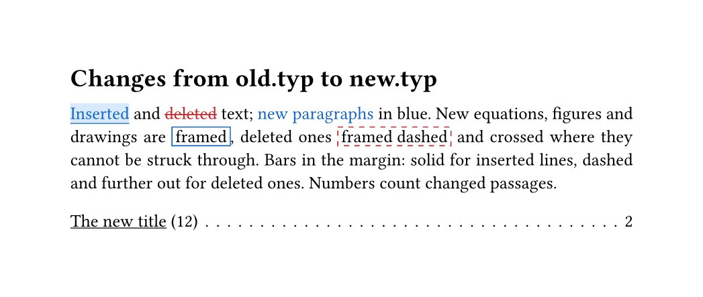
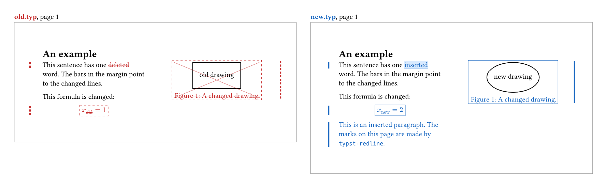
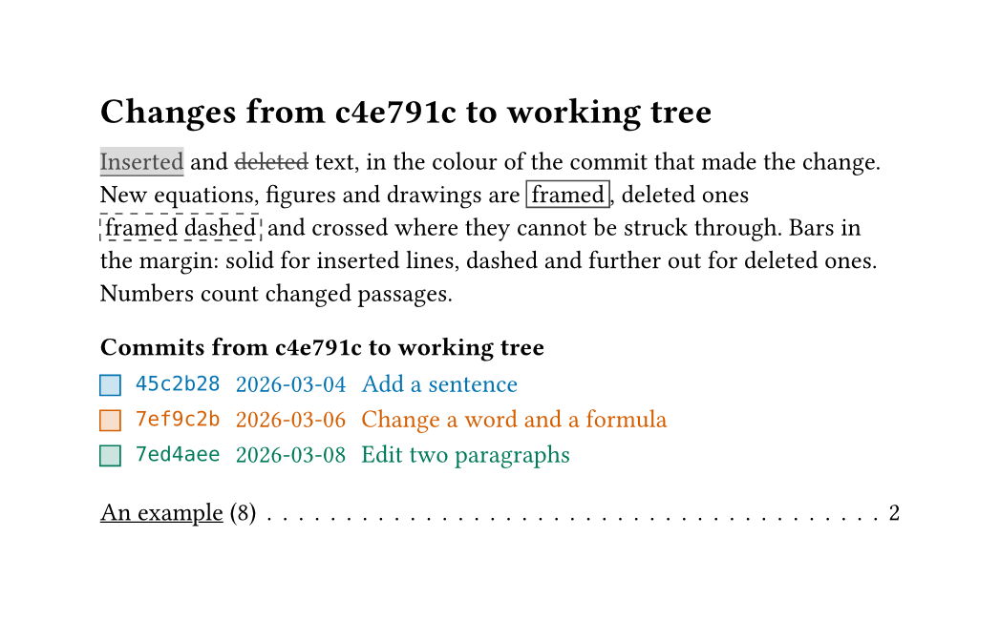
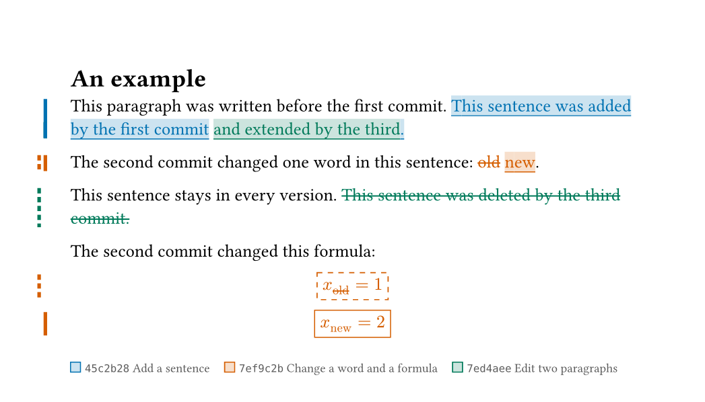

# typst-redline

`typst-redline` shows what changed between two versions of a [Typst](https://typst.app) document: a PDF of the new version with deleted text struck out and new text highlighted. It does for Typst what `latexdiff` does for LaTeX. AI agents wrote this tool.

The two pictures are the PDF made from [docs/example/old.typ](docs/example/old.typ) and [docs/example/new.typ](docs/example/new.typ). The document comes first, with the changes marked; the last page is a summary, and a small line at the top of the first page says where it is and how many changes it lists that are not marked in place:


The summary explains the marks and lists the sections that changed. When the two versions come from git, it also lists the commits between them. The summary has the page setup of the document's leading `#set` rules but not its template, show rules, header or footer.



With `--layout side-by-side`, the old page is shown next to the new one instead:



## Install

`typst-redline` runs the [`typst`](https://github.com/typst/typst#installation) on your `PATH` to compile, and [git](https://git-scm.com/downloads) for comparisons with git revisions; comparing two files needs no git.

Download the archive for your platform from the [Releases page](https://github.com/cvsvensson/typst-redline/releases):

| Platform | Archive |
|---|---|
| Linux x86_64 | `typst-redline-x86_64-unknown-linux-musl.tar.gz` |
| Linux ARM64 | `typst-redline-aarch64-unknown-linux-musl.tar.gz` |
| macOS Apple silicon | `typst-redline-aarch64-apple-darwin.tar.gz` |
| macOS Intel | `typst-redline-x86_64-apple-darwin.tar.gz` |
| Windows x86_64 | `typst-redline-x86_64-pc-windows-msvc.zip` |

Unpack it and put `typst-redline` (`typst-redline.exe` on Windows) in a folder on your `PATH`, such as `~/.local/bin`. The Linux binaries are statically linked and need no particular distribution. Each archive has a `.sha256` checksum file next to it. On Linux and macOS, one command does it, here for Apple silicon:

```sh
curl -sSL https://github.com/cvsvensson/typst-redline/releases/latest/download/typst-redline-aarch64-apple-darwin.tar.gz   | tar -xz -C ~/.local/bin typst-redline
```

The macOS binaries are not notarized. If you download one with a browser, macOS marks it as quarantined and refuses to run it; `xattr -d com.apple.quarantine ~/.local/bin/typst-redline` removes the mark. Files downloaded with `curl` are not marked.

With [Rust](https://rustup.rs), you can instead build it from source:

```sh
cargo install --git https://github.com/cvsvensson/typst-redline
```

## Use

```sh
typst-redline paper.typ                    # changes since the last commit
typst-redline paper.typ --since HEAD~3     # changes since an earlier commit
typst-redline paper.typ --since v1..v2     # changes between two commits
typst-redline old.typ new.typ              # changes between two files, no git needed
```

The result is `paper.redline.pdf` next to your file; `-o out.pdf` puts it elsewhere. Anything git accepts works after `--since`: a commit hash, a tag, a branch name. `--since main...feature` shows what a branch changed since it left `main`.

To see what changed since you last read a document, run `typst-redline paper.typ --mark-reviewed` when you have read it, and later `typst-redline paper.typ --since reviewed`. The mark records the last commit, which must contain the document, in a local git ref under `refs/typst-redline/reviewed/`, one per document; `git push` does not send it by default, and it does not show among branches or tags. If the repository has a branch or tag named `reviewed`, `--since reviewed` means that instead and says so on stderr. `git update-ref -d <ref>`, with the ref that `--mark-reviewed` prints, removes a mark.

If your document uses files outside its own folder, such as `#import "../macros.typ"`, pass the project folder with `--root`, as you would to `typst compile`. Without `--root`, the `TYPST_ROOT` environment variable is used if it is set, and otherwise the folder of the file. The compiler used is the `typst` on your `PATH`; `--typst <path>` picks another one. Arguments after `--` go to `typst compile`, for example `-- --font-path fonts`. `typst-redline --help` lists all options.

## What is marked

- **Text:** deleted words are struck through in red, new words are highlighted in blue, and a wholly new paragraph is blue. This also works inside headings, list items, captions, bold and emphasized text.
- **Formulas, figures, code blocks and drawings** are shown whole: the old one in a dashed red frame, the new one in a blue frame. An old drawing, image or shape is crossed out. A drawing in a box in the text, such as an icon, gets a frame of its own size. Code blocks, drawings and boxes or tables with a fill of their own keep their colours inside the frame. Where the text is light, as on a dark slide, deleted words get a light background and new paragraphs a lighter blue.
- **Bars in the margin** point to every changed line, dashed for deletions and solid for insertions.
- **Several files:** changes in files that the document includes or imports are marked too. With git, the old versions of those files, and of images the old text uses, are taken from the old commit.
- **Moved text:** a paragraph, heading, list item or section moved elsewhere, also into another file, is shown once, unmarked at its new place, with a grey bracket and a blue "moved" note in the margin. A grey line with a red arrow at its old place names its first words and links to it. Edits made while moving are marked as usual. `--no-moves` shows moved text as deleted at one place and inserted at the other.
- **Code:** a change inside the `[...]` content arguments of a call, such as a template's title or abstract, is marked like other text. A call whose other arguments change is marked whole: the old call deleted, the new one inserted. Code that does not show on the page, such as a function body or a `#set` rule, cannot be marked: the summary page lists the changed lines or arguments, old and new, as *changed code not marked*.
- **Changes that do not reach the page:** a mark inside content that the document never shows, or that a function reads as text instead of laying it out (a table built from `|`-separated text, for example), is lost with that content. The summary page lists each such change with its source text, and a moved passage whose new place is lost by its first words. A change inside `hide` gets no bars and is listed there too; content made invisible otherwise, such as text in a transparent colour, counts as shown.
- **Files the document reads:** when an image or data file changes while the call that reads it (`image`, `json`, `csv`, `read` and similar) stays the same, the summary page lists the file as changed. With Typst 0.14 and later, this also holds for files read through a computed path, such as `#include chapter + ".typ"` or `json(name + ".json")`: typst reports which files the document read, and a Typst file included or imported that way is marked like any other, or listed if the document also reads files as text through a computed path.

With the deleted parts removed, the marked document has the same text, layout and numbering as the new version; states are the exception (see Known problems). Deleted figures and equations are numbered where they stand without shifting the numbers after them. Other numbers in deleted text, including those of references, follow the new document's numbering, so a deleted reference points to the right place in this PDF; the side-by-side layout shows the old numbers.

## Who changed what

`--each-commit` gives each commit between the two versions that changes the document or a file it includes its own colour, for up to 6 commits. Deleted text is still struck through and new text still highlighted; the colour tells which commit made the change. The list of commits on the summary page is the legend, and each page with marks repeats it in one small line in the bottom margin when there is room.

```sh
typst-redline paper.typ --since HEAD~4 --each-commit
```

The pictures show a document changed by three commits; its versions are in [docs/example-commits](docs/example-commits). The summary page:



The marked page:



For more commits, `--steps` groups them into up to 6 steps, each in its own colour. Name the revisions where steps end, and the last step ends at the new version:

```sh
typst-redline paper.typ --since v1 --steps a1b2c3,submitted
```

gives three steps: `v1..a1b2c3`, `a1b2c3..submitted` and from `submitted` to the working tree, including uncommitted changes. With a number, the tool splits the commits, and then the uncommitted changes, into that many steps that change about the same amount of the document: `--steps 3`. The summary page lists each step with its range, the date of its last commit, its number of commits and the first few commit subjects. A step whose commits do not touch the document still gets its colour and is listed as making no changes.

Only the first and the last version are compared, so text that one commit added and a later one removed does not appear. A deleted passage, formula or figure that several commits changed takes the colour of the commit that changed most of it. `--each-commit` and `--steps` need a git comparison in which the old revision is an ancestor of the new one (for a branch, give `--since main...feature`); they do not work with two plain files. With `--layout side-by-side`, the list of commits is under each pair of pages.

## Slides and side-by-side

`--layout side-by-side` puts each changed page of the old version next to the same page of the new version, as in the third picture above, and leaves out pages without changes. The first page of the PDF lists which pages are shown and how many were left out. It works for any document and needs Typst 0.14 or later.

```sh
typst-redline talk.typ --since HEAD~1 --layout side-by-side
```

This is the layout to use for slides. In the default layout the deleted content is shown on the same page as the new content, so the page holds more than it was designed for; a slide has a fixed size, and a full one overflows. Side by side, each page holds only the content of its own version.

## Known problems

- Some moved text still shows as deleted in one place and inserted in another: a sentence moved within or between paragraphs, a nested list item moved on its own, a short passage of fewer than four words, such as a short list item or a one-line paragraph, unless it moves together with a longer one next to it, text inside a call's content block such as `#slide[...]`, text moved into or out of a file that is not shown in order (imported, included by code, or no longer included), a passage rewritten so much that it keeps less than about 60% of its words, or of its rarer words, and moved setup code such as `#set` and `#let`.
- Where a function reads its content as text, the changed text is missing from the page, not only its mark; the summary page lists it.
- With Typst 0.11 to 0.13, a changed file that the document reads only through a computed path is neither marked nor listed; the summary page says that such files were not checked. Files outside the project root and package files are not checked.
- A blank line added between list items, or removed, makes the list loose or tight and changes its spacing, but is not marked.
- Paragraphs reordered inside a moved section show as deleted and inserted inside it.
- A moved passage in a middle column of a page with three or more columns, and one in a narrow margin, has a bracket but no "moved" note.
- Deleted content shifts line and page breaks compared with the new version.
- Deleted content that updates a state, for example in a show rule of a package, leaves the state changed after it, because Typst records no initial value to set it back to. What reads the state later can differ from the new version; the summary page names such states. Counters are set back.
- In deleted code, a label passed as a named argument or written in math is taken to be attached by the code and is renamed; a label passed positionally is taken to be a reference. Code that uses labels the other way makes the tool show deleted code by name.
- Deleted content is laid out under the new version's show and set rules, so where such a rule changed, deleted content does not look as it did in the old version. The side-by-side layout shows the old pages as they were.
- Show rules on `strike`, `highlight` or `text` in your document also restyle the marks.
- With Typst 0.11, right-to-left text gets no change bars, and a deletion in it fails to compile, because that version orders the tags in such text by position.
- A text show rule with a `regex` selector stops matching where a mark cuts its match. For a string selector, such as `#show "Typst": smallcaps`, the mark is widened to cover the match.
- Deleted figures, equations and citations are still figures, equations and citations, so the document's own queries for them, such as a list of figures built with `query(figure)`, also find the deleted ones. `outline` leaves them out.
- A box or table deleted or inserted whole whose fill comes from a `set` or `show` rule has its text coloured like other text, which can be hard to read on a dark fill.
- A citation added to or removed from a group such as `@a @b` marks the whole group, because Typst lays the group out as one piece.
- Entries that appear in, disappear from or change in the bibliography are not marked there. The summary page names them.
- When a figure's call and its image file both change, the old figure is drawn with the new image file.
- A changed element that sets the page from inside a function, such as a slide, cannot be framed. The document is then compiled again with no frames around content computed at layout (calls of functions built on `context` or `layout`, which includes many drawings), and the summary page says so. With Typst 0.11, a changed drawing that needs a finite width has the same effect.
- Pages where your document or its template sets both its own page foreground and background get no margin bars. The summary page lists those pages, unless the first page is one of them; the first page then also has no line pointing to the summary.
- In side-by-side, an inserted or deleted page is shown next to an empty one only when the pages have headings; otherwise it can be paired with a neighbouring page.

## Styling

Colours and other settings are in the `redline-style` dictionary at the top of [src/preamble.typ](src/preamble.typ). Copy that file, edit it, and pass it with `--preamble my-style.typ`. The six colours of `--each-commit` and `--steps` are in `redline-style.steps`. Changed code that is not marked reaches `redline-summary` and `redline-side-by-side` as `(old, new)` pairs of strings, either empty for inserted or deleted code; a preamble copied from a version that took plain strings there must be copied again. A custom preamble's `redline-ins` and `redline-del` must also take the `id` argument that every mark other than a move's carries.

## VS Code

The extension in `vscode/` runs `typst-redline` on the open `.typ` file. It needs `typst-redline` installed as above and is not on the Marketplace; build it with Node.js and install the `.vsix` by hand:

```sh
cd vscode
npm ci
npm run package     # makes typst-redline-0.1.0.vsix
code --install-extension typst-redline-0.1.0.vsix
```

or use *Extensions: Install from VSIX…* in VS Code. It adds two commands:

- *Typst Redline: Show changes since…* lists the commits of the open file, the last reviewed version and *Another file…*, then asks for options: side by side, colour by commit, colour by step and no moves. It saves the open `.typ` files, runs the tool with a progress notification, which can cancel it, and opens the PDF. Notes and warnings of the tool show as a notification and in the *Typst Redline* output.
- *Typst Redline: Mark as reviewed* runs `--mark-reviewed` for the open file.

The settings are `typstRedline.executable` and `typstRedline.typst` for the paths of the two programs, `typstRedline.root` for `--root` (by default the workspace folder), `typstRedline.extraArgs` for further arguments, such as `["--", "--font-path", "fonts"]`, and `typstRedline.openPdf`. The PDF opens beside the document in VS Code when a PDF viewer extension is installed, otherwise in the system viewer.

## Claude Code

[`claude-plugin/`](claude-plugin) is a plugin with a skill for compiling a Typst document and making its redline, for requests like *"send me the notes and what changed since Monday"*. Install it with

```
/plugin marketplace add cvsvensson/typst-redline
/plugin install typst-redline@typst-redline
```

or enable it for a project in its `.claude/settings.json`:

```json
{
  "extraKnownMarketplaces": {
    "typst-redline": { "source": { "source": "github", "repo": "cvsvensson/typst-redline" } }
  },
  "enabledPlugins": { "typst-redline@typst-redline": true }
}
```

## See also

[typdiff](https://github.com/sou1118/typdiff) and [typst-diff](https://github.com/alexanderkoller/typst-diff) are other tools for the same job.

## License

MIT
