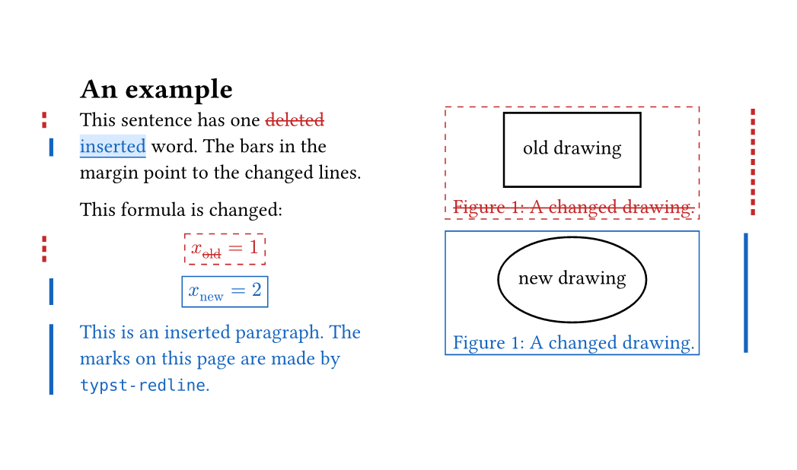
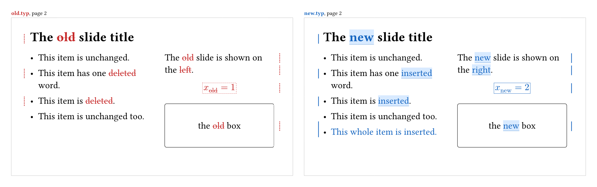

# typst-redline

`typst-redline` shows what changed between two versions of a [Typst](https://typst.app) document: a PDF of the new version with deleted text struck out and new text highlighted. It does for Typst what `latexdiff` does for LaTeX. AI agents wrote this tool.



The picture is page 2 of the PDF made from [docs/example/old.typ](docs/example/old.typ) and [docs/example/new.typ](docs/example/new.typ). Page 1 is a summary that explains the marks and lists the sections that changed and, when the two versions come from git, the commits between them:


## Install

You need [Typst](https://github.com/typst/typst#installation), [git](https://git-scm.com/downloads) and [Rust](https://rustup.rs). Then:

```sh
cargo install --git https://github.com/cvsvensson/typst-redline
```

## Use

```sh
typst-redline paper.typ                    # changes since the last commit
typst-redline paper.typ --since HEAD~3     # changes since an earlier commit
typst-redline paper.typ --since v1..v2     # changes between two commits
typst-redline old.typ new.typ              # changes between two files, no git needed
```

The result is `paper.redline.pdf` next to your file; `-o out.pdf` puts it elsewhere. Anything git accepts works after `--since`: a commit hash, a tag, a branch name. `--since main...feature` shows what a branch changed since it left `main`.

If your document uses files outside its own folder, such as `#import "../macros.typ"`, pass the project folder with `--root`, as you would to `typst compile`. The compiler used is the `typst` on your `PATH`; `--typst <path>` picks another one. Arguments after `--` go to `typst compile`, for example `-- --font-path fonts`. `typst-redline --help` lists all options.

## What is marked

- **Text:** deleted words are struck through in red, new words are highlighted in blue, and a wholly new paragraph is blue. This also works inside headings, list items, captions, bold and emphasized text.
- **Formulas, figures and drawings** are shown whole: the old one in a dashed red frame, the new one in a blue frame. An old drawing, image or empty shape is crossed out.
- **Bars in the margin** point to every changed line, dashed for deletions and solid for insertions.
- **Several files:** changes in files that the document includes or imports are marked too. With git, the old versions of those files, and of images the old text uses, are taken from the old commit.
- **Code:** a change to code, such as a function body or a `#set` rule, cannot be shown as a mark. The summary page lists it as *changed code not marked*, so no change goes unreported.

With the deleted parts removed, the marked document has the same text, layout and numbering as the new version.

## Who changed what

`--each-commit` gives each commit between the two versions its own colour, for up to 6 commits. Deleted text is still struck through and new text still highlighted; the colour tells which commit made the change. The list of commits on the summary page is the legend, and each page with marks repeats it in one small line in the bottom margin when there is room.

```sh
typst-redline paper.typ --since HEAD~4 --each-commit
```

Only the first and the last version are compared, so text that one commit added and a later one removed does not appear. A deleted passage, formula or figure that several commits changed takes the colour of the commit that changed most of it. `--each-commit` does not work with two plain files or with `--layout side-by-side`.

## Slides and side-by-side

Deleted content takes room, so a full slide can overflow. `--layout side-by-side` puts each changed page of the old version next to the same page of the new version, and leaves out pages without changes. It works for any document and needs Typst 0.14 or later.

```sh
typst-redline talk.typ --since HEAD~1 --layout side-by-side
```



The picture is made from [docs/example-slides/old.typ](docs/example-slides/old.typ) and [docs/example-slides/new.typ](docs/example-slides/new.typ). The first page of that PDF lists which pages are shown and how many were left out.

## Known problems

- Moved text shows as deleted in one place and inserted in another.
- Deleted content shifts line and page breaks compared with the new version.
- Show rules on `strike`, `highlight` or `text` in your document also restyle the marks.
- A citation added to or removed from a group such as `@a @b` marks the whole group, because Typst lays the group out as one piece.
- Entries that appear in, disappear from or change in the bibliography are not marked there. The summary page names them.
- Pages where your document or its template sets both its own page foreground and background get no margin bars. The summary page lists those pages.
- In side-by-side, an inserted or deleted page is shown next to an empty one only when the pages have headings; otherwise it can be paired with a neighbouring page.

## Styling

Colours and other settings are in the `redline-style` dictionary at the top of [src/preamble.typ](src/preamble.typ). Copy that file, edit it, and pass it with `--preamble my-style.typ`. The six colours of `--each-commit` are in `redline-style.steps`.

## VS Code

The extension in `vscode/` adds the command *Typst Redline: Show changes since…*: pick a commit of the open file and it opens the PDF. It needs `typst-redline` installed as above. Build it with `npm install && npm run package` in `vscode/` and install the resulting `.vsix` with *Extensions: Install from VSIX…*.

## Claude Code

[`claude-plugin/`](claude-plugin) is a plugin with a skill for compiling a Typst document and making its redline, for requests like *"send me the notes and what changed since Monday"*. Install it with

```
/plugin marketplace add cvsvensson/typst-redline
/plugin install typst-redline@typst-redline
```

or enable it for a project in its `.claude/settings.json`:

```json
{
  "extraKnownMarketplaces": {
    "typst-redline": { "source": { "source": "github", "repo": "cvsvensson/typst-redline" } }
  },
  "enabledPlugins": { "typst-redline@typst-redline": true }
}
```

## See also

[typdiff](https://github.com/sou1118/typdiff) and [typst-diff](https://github.com/alexanderkoller/typst-diff) are other tools for the same job.

## License

MIT
