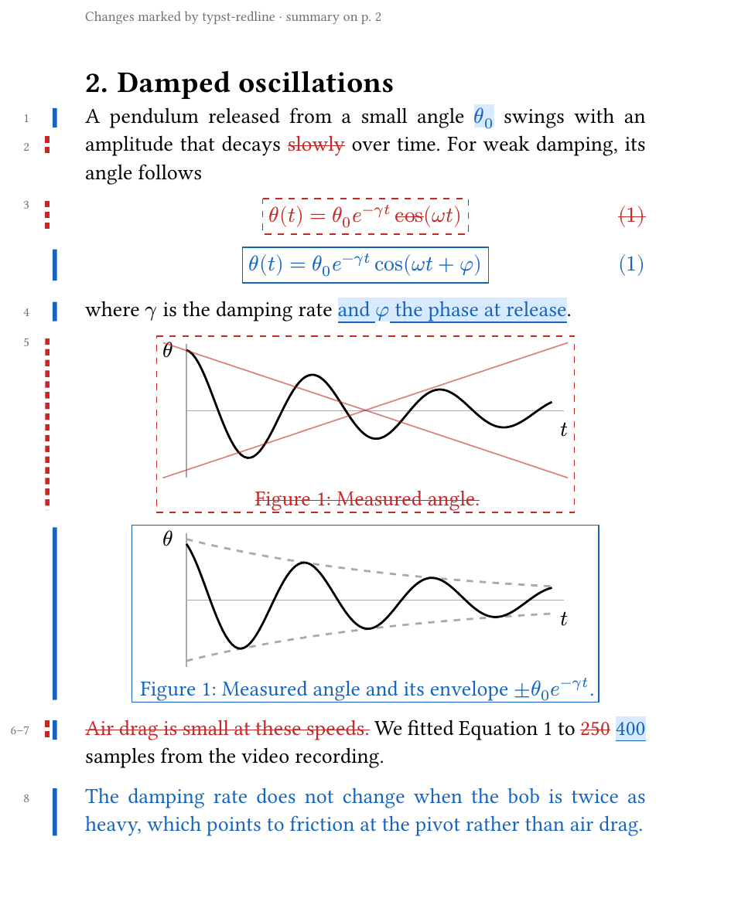

# typst-redline

Like latexdiff, for Typst.

`typst-redline` shows what changed between two versions of a [Typst](https://typst.app) document. It makes a PDF of the new version with deleted text struck out, new text highlighted, changed formulas and figures framed, and bars and change numbers in the margin; a summary at the end lists every change, including those it cannot mark on the page. AI agents wrote this tool.



The [gallery](docs/gallery.md) shows every kind of mark, each with the files it was made from.

## Install

`typst-redline` compiles with the [`typst`](https://github.com/typst/typst#installation) on your `PATH`, and uses [git](https://git-scm.com/downloads) for comparisons with commits; comparing two files needs no git.

No release has been published yet, so install it with [Rust](https://rustup.rs):

```
cargo install --git https://github.com/cvsvensson/typst-redline
```

Run the same command with `--force` to update, and `cargo uninstall typst-redline` to remove it; the [`cargo install` documentation](https://doc.rust-lang.org/cargo/commands/cargo-install.html) says where it puts the program. `typst-redline --version` checks that it is found.

CI runs the tests with Typst 0.15.1 on Linux, macOS and Windows, and with Typst 0.14.2 on Linux ([ci.yml](.github/workflows/ci.yml)); [Known problems](docs/known-problems.md#typst-versions) says what is known about other versions.

## Use

In a git repository:

```
typst-redline paper.typ                    # uncommitted changes, since the last commit
typst-redline paper.typ --since HEAD~3     # changes since three commits ago
typst-redline paper.typ --since v1         # changes since a tag, branch or commit hash
typst-redline paper.typ --since v1..v2     # changes between two commits
```

Run `typst-redline` without a file in a terminal and it asks which file and which version to compare with, then prints the command it runs and runs it. Files that another file in the folder includes come last, and with one document there is no file question. The versions are the last reviewed version, the changes since the last commit, and the newest commits that change the document's files, each where it applies:

```
Using paper.typ, the only Typst document in this folder.
typst-redline --help lists the options; q quits.
Show the changes to paper.typ.
A commit stands for its own change and every change after it.
   1  the last reviewed version
   2  changes since the last commit
   3  8e8568b  2026-11-19  Revise the body
   4  4dc47c8  2026-11-19  Expand the introduction
Number [1]: 4
typst-redline paper.typ --since 833bb8f
```

Enter takes the first entry and `q` quits. Other options, such as `--layout side-by-side`, apply as given.

Without git, compare two copies; quote paths that contain spaces:

```
typst-redline "thesis v1/thesis.typ" "thesis v2/thesis.typ"
```

The PDF is written next to the file, or next to the new file when you give two, as `<name>.redline.pdf`, and its path is printed. `-o out.pdf` writes it elsewhere. With one file, the new version is the file as it is on disk, uncommitted changes included, unless `--to <revision>` names another.

If the document reads files outside its own folder, such as `#include "../shared/intro.typ"`, pass the folder that holds all of its files with `--root`, for example `typst-redline thesis/main.typ --root .` from that folder. Without `--root`, the `TYPST_ROOT` environment variable is used if it is set, and otherwise the folder of the file. `--typst <path>` picks another `typst` than the one on `PATH`, and arguments after `--` go to `typst compile`, for example `-- --font-path fonts`. `--keep-typ` keeps the marked Typst source and prints where it is, and `--list-files` prints the paths of the files the document is made of. `typst-redline --help` lists every option.

## What is marked

- Deleted text is struck out in red and new text highlighted in blue, also in headings, lists, captions and footnotes.
- A changed formula, figure, table, code block or drawing is shown whole: the old one in a dashed red frame, the new one in a blue frame.
- A bar in the margin points to every changed line, dashed for deletions and solid for insertions, with a number for each change that the summary page uses too.
- A moved paragraph or section is shown once, at its new place, with a "moved" note; at its old place a grey line links to it.
- Changes in included files and replaced images are marked; with git, the old version of each file comes from the old commit.
- What cannot carry a mark, such as a title given as a string, a `#set` rule, a data file or a bibliography entry, is listed on the summary page.

The [gallery](docs/gallery.md) has a picture and the details of each. With the deleted parts removed, the marked PDF has the same text, layout and numbering as the new version; [Known problems](docs/known-problems.md#deleted-content-in-the-new-layout) lists the exceptions.

## The summary page

The last page, or pages, list every change by its number, section by section, and say in words what is not marked on the pages, with its source. A line at the top of the first page says where the summary is and how many changes it lists that are not marked on the pages. The [gallery](docs/gallery.md#the-summary-page) describes each part.


## Slides and side by side

`--layout side-by-side` shows each changed page of the old version next to the same page of the new version, leaves out pages without changes, and ends with the summary. Use it for slides: in the default layout, deleted content takes room on the page, so a full slide overflows. It needs Typst 0.14 or later and an old version that compiles; the default layout falls back to coarser marks instead.

```
typst-redline talk.typ --since HEAD~1 --layout side-by-side
```


## Recipes with git

**Send a co-author what changed since the version they read.** Tag the commit you sent, `git tag sent-to-anna`, and later run `typst-redline paper.typ --since sent-to-anna`. The summary lists the commits in between.

**What changed since you last read it.** When you have read the document, run `typst-redline paper.typ --mark-reviewed`; later, `typst-redline paper.typ --since reviewed` shows what changed since. The mark is the last commit, kept in a local git ref per document, printed when you set it; `git push` does not send it, and `git update-ref -d <that ref>` removes it. If the repository has a branch or tag named `reviewed`, `--since reviewed` means that instead and says so on stderr. `typst-redline paper.typ --show-reviewed` prints the hash of the commit `--since reviewed` uses, or nothing if there is none.

**What changed since a date.** Find the last commit before it and compare with that: `typst-redline paper.typ --since $(git rev-list -1 --before="2026-11-16 00:00" HEAD)`. If no commit is that old, `typst-redline` stops with *--since needs a value*.

**What a branch changed**: `typst-redline paper.typ --since main...feature` compares the point where `feature` left `main` with `feature`.

**Who changed what.** `--each-commit` gives each commit between the two versions its own colour, for up to 6 commits that change the document or a file it reads. The commits are listed in their colours on the summary page and in one small line in the bottom margin of each marked page ([picture](docs/gallery.md#who-changed-what)).

```
typst-redline paper.typ --since sent-to-anna --each-commit
```

For more commits, `--steps` groups them into up to 6 steps, each in its own colour: `--steps 3` splits them into three steps that change about the same amount, and `--steps a1b2c3,submitted` ends steps at those revisions, the last step at the new version, uncommitted changes included. The summary lists each step with its range, date and commit subjects.

Only the first and the last version are compared, so text that one commit added and a later one removed does not appear, and a passage that several commits changed takes the colour of the commit that changed most of it. Both options need the old revision to be an ancestor of the new one, and do not work with two plain files.

## Known problems

The ones you are most likely to meet; [docs/known-problems.md](docs/known-problems.md) has the full list, each tried with the current version.

- In the default layout, deleted content takes room on the page, so line and page breaks shift, and on a full slide the old and the new version of a figure each take a page of their own; use side by side for slides.
- Some moved text shows as deleted at one place and inserted at the other, for example a sentence moved within or between paragraphs, or a passage rewritten so much that it keeps less than about 60% of its words.
- Where a function reads its content as text, a changed text can be missing from the page, not only its mark, and a function that fails on marked content makes the whole document fall back to coarser marks; the summary page says so in both cases.
- Deleted code that uses a name which meant something else at its place, such as a loop variable or a function parameter, is shown by that name, such as *[unit]*, not as it looked.
- Deleted content is laid out under the new version's show and set rules, and a reference in it to a label that the new version lacks shows the label, not the number the old version printed.
- Typst 0.12 and 0.13 are not tested; before Typst 0.14, side by side does not work and a file read only through a computed path, such as `#include name + ".typ"`, is not checked for changes.

## Styling

Colours and other settings are in the `redline-style` dictionary at the top of [src/preamble.typ](src/preamble.typ). Copy that file, edit it, and pass it with `--preamble my-style.typ`; the six colours of `--each-commit` and `--steps` are in `redline-style.steps`. The tool passes data to the functions in the preamble, and that data changes between versions, so copy the preamble again from the version you run after each update.

## VS Code

Open a `.typ` file and click the compare button in the editor's title bar to see what changed, as a PDF with the changes marked.

The extension in [`vscode/`](vscode) runs `typst-redline` on the open `.typ` file. It needs `typst-redline` installed as above and is not on the Marketplace; build it with Node.js and install it by hand:

```
cd vscode
npm ci
npm run package     # makes typst-redline-0.1.0.vsix
code --install-extension typst-redline-0.1.0.vsix
```

or use *Extensions: Install from VSIX...* in VS Code. VS Code finds `typst-redline` on the `PATH` it started with, so restart it after installing the tool. The extension is turned off in Restricted Mode, because it runs git and the programs its settings name.

To see what changed:

1. Open the main `.typ` file of the document.
2. Run *Typst Redline: Show changes...* with the compare button in the editor's title bar, from the Command Palette, or from the right-click menu of a `.typ` file in the Explorer.
3. Pick what to show, or press Enter for the first entry of the list. The PDF opens beside the document if a PDF viewer extension is installed, otherwise in the system viewer.
4. When you have read it, run *Typst Redline: Mark as reviewed*. It marks the commit that is checked out; uncommitted changes are not part of it.

Outside a git repository, or with no commits to list, the command asks for the older version's file at once; *Typst Redline: Choose view* in the Command Palette changes the view there. To compare two files, select both in the Explorer, right-click and pick *Show changes between these files*; a short list asks which one is the newer version, offering the one changed last first.

The list starts with *Last reviewed version*, the changes since the commit you last marked, once there is one; then *Changes since the last commit*, when the document's files have changes that are not committed, unsaved edits included, which are saved before the run; then the commits that change the document's files, newest first. **A commit stands for its own change and every change after it**, here and in every other list of commits. The first commit of the repository has no version before it and is not listed. After the commits come *Another file...*, which compares with a `.typ` file of your choice, *Several commits...* and *More options...*.

**The view.** *More options...* shows the current view, *Marked* at first, and *View* there changes it and returns to the list; the workspace keeps the view until you change it.

- *Marked* ([picture](docs/gallery.md#text-formulas-and-figures)): the new version with the changes marked.
- *Side by side* ([picture](docs/gallery.md#slides-side-by-side)): changed pages of the old and the new version next to each other. Needs Typst 0.14 or later.
- *Marked, coloured by commit* ([picture](docs/gallery.md#who-changed-what)) and *Side by side, coloured by commit*: each change in the colour of the commit that made it. A second list chooses *One colour per commit* or *2 steps* to *6 steps*, which split the commits into groups of about equal change. One colour per commit with more than six commits gives six steps. Where there is nothing to colour, as with another file, the changes are shown in the same layout without colours, and a notification says so.

**More ways to compare.**

- *Several commits...* lets you tick up to six commits: every change from the oldest ticked commit on is shown, and each ticked commit starts a new colour, which the commits after it share up to the next tick. It uses the layout of the view.
- *Between two commits...*, under *More options...*, asks for the oldest and the newest commit to show; the new version is then that commit, not the file as it is now. It uses the view, colours included.

If `typst-redline` or `typst` is not found, a message says which, with a button that opens install instructions and, for `typst`, one to locate it; VS Code may need a restart after installing.

The run saves the open files of the project first, and its progress notification can cancel it. The PDF is written next to the file as `<name>.redline.pdf`. Warnings of the tool show as a notification, and everything it prints is in the *Typst Redline* output.

Settings, with their defaults:

- `typstRedline.executable`: `typst-redline`, and `typstRedline.typst`: empty, for `typst` on `PATH`.
- `typstRedline.root`: empty, for the workspace folder, or the git repository if the workspace folder contains it.
- `typstRedline.contextMenu`: `true`; `false` removes the right-click entries in the Explorer.
- `typstRedline.openPdf`: `auto`; `editor` or `external` choose one place.
- `typstRedline.extraArgs`: empty; further arguments, such as `["--no-moves"]` or `["--", "--font-path", "fonts"]`. The command sets `--since`, `--to`, `--layout`, `--each-commit` and `--steps` itself and refuses to run if this setting holds one of them.

## Claude Code

[`claude-plugin/`](claude-plugin) is a plugin with a skill that lets Claude Code compile a Typst document and make its redline, for requests like *"send me the notes and what changed since Monday"*. Install it with

```
/plugin marketplace add cvsvensson/typst-redline
/plugin install typst-redline@typst-redline
```

## See also

Other tools that compare Typst documents: [typdiff](https://github.com/sou1118/typdiff) and [typst-diff](https://github.com/alexanderkoller/typst-diff).

## License

MIT
