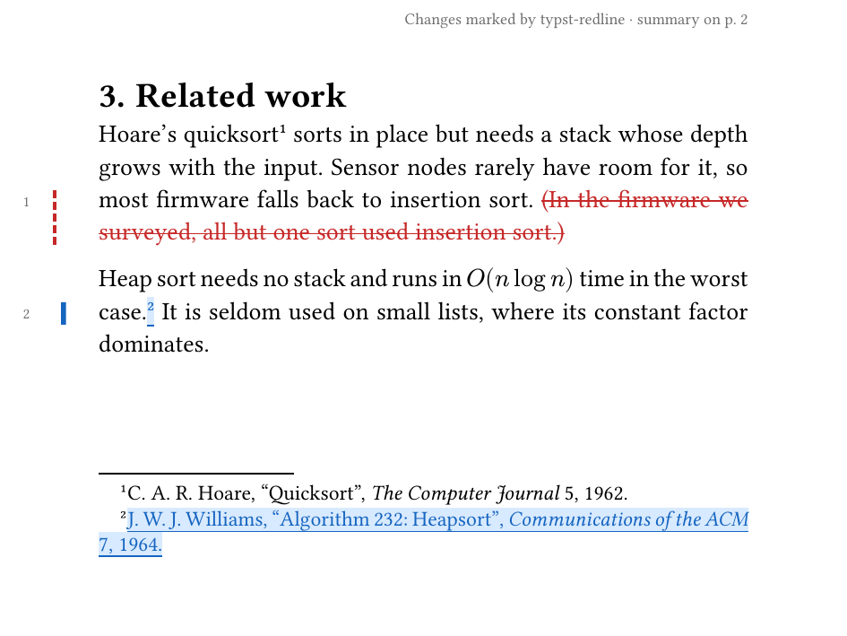
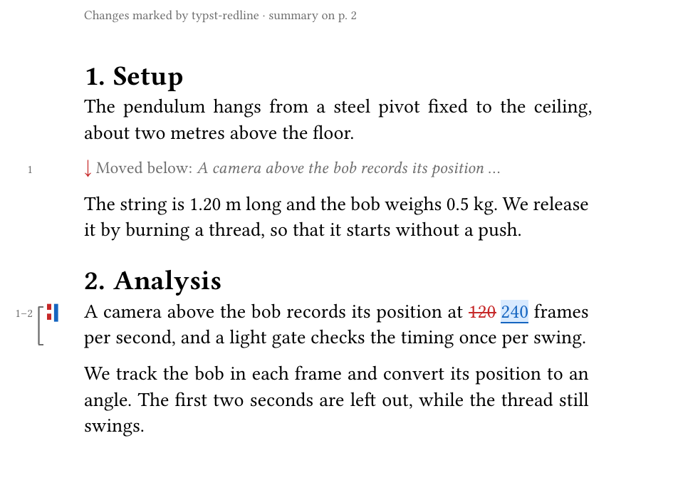
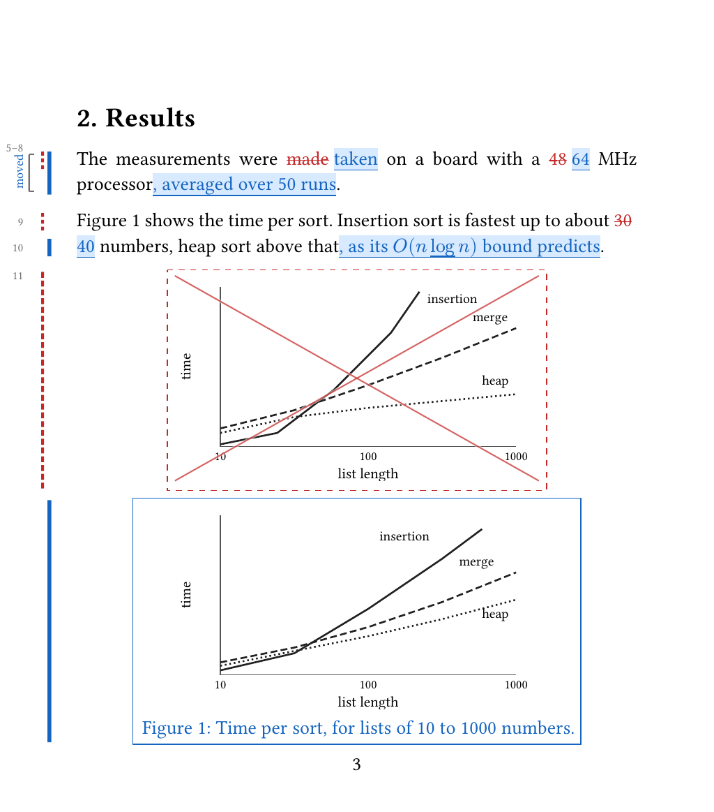

# Gallery

Each picture is a page of a PDF that `typst-redline` made from the files linked next to it, rendered unchanged. [make-pictures.sh](make-pictures.sh) makes them all again. [Known problems](known-problems.md) lists the cases where the marks fall short.

## Text, formulas and figures

Deleted words are struck out in red and new ones highlighted in blue; a new paragraph is blue. The old formula is tinted in a dashed red frame above the new one in a blue frame. The figure's plot changed: the old plot, crossed out, stands before the new figure, whose caption appears once with its new words marked. The equation and the figure keep their numbers. Bars in the margin mark each changed line, with the number of each change next to them; the old and the new formula are one change and share a number, and a line with two changes is labelled *7–8*.

```
typst-redline old.typ new.typ
```


Files: [paper/old.typ](paper/old.typ), [paper/new.typ](paper/new.typ).

Text is marked the same way inside headings, list items, captions, bold and emphasized text. A deleted list item stays in its list, with its old marker or number in red, and a deleted line break shows as a struck ↵ instead of breaking the line. A new or removed citation is marked in the text. Where the text is light, as on a dark slide, deleted words get a light background and new paragraphs a lighter blue.

In an old formula, figure, code block or drawing, text is struck through where it can be; an image or a drawing, such as a plot, is crossed out, and anything else, such as a formula, a table, a code block or a chart built from boxes, is tinted red. A drawing in a box in the text, such as an icon, gets a frame of its own size. Code blocks and filled boxes keep their colours inside the frame.

Change numbers count in the reading order of the new version, so that a co-author can write "change 14 is wrong". A change in a column between others, or next to a margin too narrow for its number, has its number in the other margin on the same line.

## Footnotes

A new footnote is highlighted at the foot of the page. A deleted footnote is struck through in parentheses where it stood, so that the remaining footnotes keep the new version's numbers.

```
typst-redline old.typ new.typ
```



Files: [footnotes/old.typ](footnotes/old.typ), [footnotes/new.typ](footnotes/new.typ).

## Moved text

The camera paragraph moved from *Setup* to *Analysis*, and its frame rate changed on the way. It is shown once, at its new place, with a grey bracket and a "moved" note in the margin; the edit is marked as usual. At the old place, a grey line names its first words and links to it. Both places show the move's number, 1; the changed frame rate is change 2.

```
typst-redline old.typ new.typ
```



Files: [moved/old.typ](moved/old.typ), [moved/new.typ](moved/new.typ).

Headings, list items and whole sections are shown as moved in the same way, also when they move into another file. `--no-moves` shows moved text as deleted at one place and inserted at the other.

## Several files and git

A report whose chapters are separate files, compared with a tagged commit three commits back. The first paragraph moved here from the introduction, which is another file. The plot is an SVG file that a later commit replaced; the `image` call did not change, and the old image, crossed out, stands above the new figure.

```
typst-redline main.typ --since draft-1
```



Files: the four commits are the folders [report/1](report/1) to [report/4](report/4), each holding the files that commit changed.

Changes in files the document includes or imports are marked where they appear; with git, the old version of each file is taken from the old commit. A changed data file read in code that does not show on the page, such as `#let data = json("data.json")`, is listed on the summary page with its name.

## The summary page

The last page of the same PDF, set without the document's header and footer. It counts the changes, gives for each section the numbers of its changes as they stand in the margin, their count and pages, and lists, by number, what has no mark on the pages: here the report's new title, which the template prints from a string argument, and a new bibliography entry. Then the commits in the range, and the legend.


From the top:

- One sentence counts the changes and how many of them are not marked on the pages. When the versions do not differ, it says *No changes found between the two versions*, the line on the first page says so too, and so does a note on stderr.
- **Changes by section**: each section with changes, the numbers of its changes, how many changes it has (not a page count; text deleted and inserted at one place is one change), how many passages moved into it, and the pages of its changes, or for a deleted section where it was. Changes before the first heading, such as in `#set` rules or a template call, are under *Start of the document*, and a change in a page header or footer is under the section whose code sets it. A heading written as a call, such as `#heading[...]`, or inside a call starts a section too. Pages are numbered as in the PDF; the column is headed *PDF page* when the document prints other page numbers.
- **Marked with a bar only**: changes that have a bar in the margin but nothing else to show, such as a blank line added before a list item, which spaces it apart, explained in words, or deleted code that draws nothing, such as a counter update, with its source; each after its number.
- **Not marked in place**: each change that has no mark on the pages, after its number, said in words with old in red and new in blue where it can be, and its source. Bibliography entries that appear, disappear or change are listed here too.
- **What this PDF shows differently**: notes on where this PDF differs from a plain proof, for example pages without bars or coarser marks; see [Known problems](known-problems.md).
- **Commits**: for a comparison with git, the commits between the two versions that change the document or a file it reads.
- **How changes are marked**: the legend, a sample of each kind of mark.

What is listed rather than marked:

- A changed string or other value, such as `title: "..."` or a colour, and changed code that does not show on the page, such as a `#set` rule or a function, are said in words, for example `title: "Sorting on small devices" → "Sorting in 32 kB"`. A changed call that shows the same as before, and a changed label, are listed too.
- A change in content that is never shown, or inside `hide`, or in text that a function reads as a string, is listed with its source text. A changed call that is itself hidden, such as `#hide(rect(...))`, gets only bars.

A change inside a content argument in brackets, such as a template's `abstract: [...]`, is marked on the page like other text. Another call whose arguments change is marked whole, old call deleted and new one inserted. When only the body of a call that also takes content by name changed, such as the image of a `#figure(image(...), caption: [...])`, the old body is shown deleted and the new figure inserted, so that its caption shows once, with edits in it marked.

The summary is set in the document's font, without its template, header, footer, foreground or background, on pages at least as wide as the document's. Its pages do not count in the document's page total, so a footer such as *page 3 of 12* reads as in the new version.

## Only the changed pages

With `--only-changes`, the PDF has only the pages that carry a mark, including the old place of moved text, and the summary. A page whose only change is listed on the summary, such as one that a changed `#set` rule redraws, is left out. The pointer line on the first page, if that page is kept, says that the summary is at the end, and the summary and margin notes name pages by the numbers printed on them, or by their place in the full PDF where a page has none.

## Who changed what

The same comparison with `--each-commit`: each change has the colour of the commit that made it, and the commits are listed in their colours in the bottom margin and on the summary page.

```
typst-redline main.typ --since draft-1 --each-commit
```


## Slides side by side

`--layout side-by-side` shows each changed slide next to its old version. Here a list item was replaced, a number changed and the chart was redrawn.

```
typst-redline old.typ new.typ --layout side-by-side
```


Files: [slides/old.typ](slides/old.typ), [slides/new.typ](slides/new.typ).

The first page lists which pages are shown, and the last pages are the same summary as in the default layout, without its legend. Change numbers are on the new pages only. A page that moved is shown next to its old page. A page that a change only listed on the summary draws differently, such as one with renumbered headings, is shown as well. Deleted content looks as it did in the old version, since the old pages are shown as they were.
