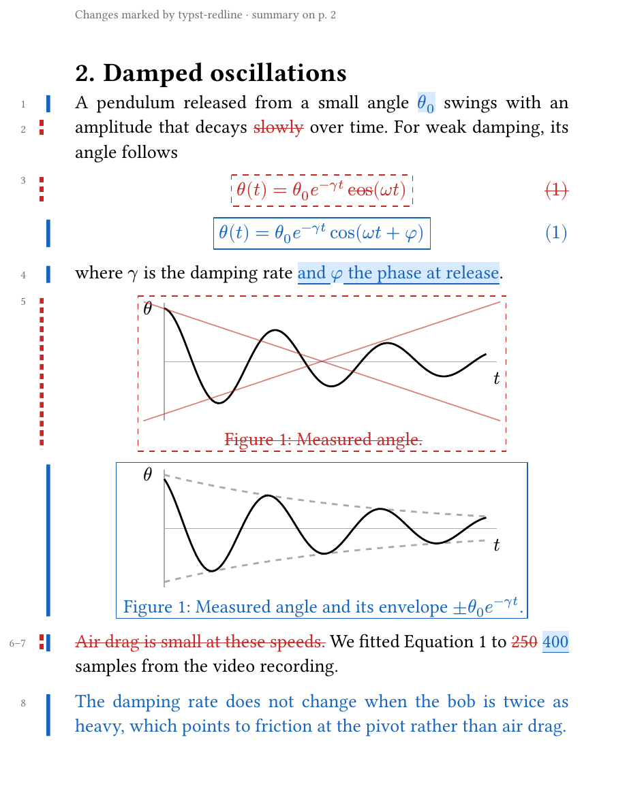
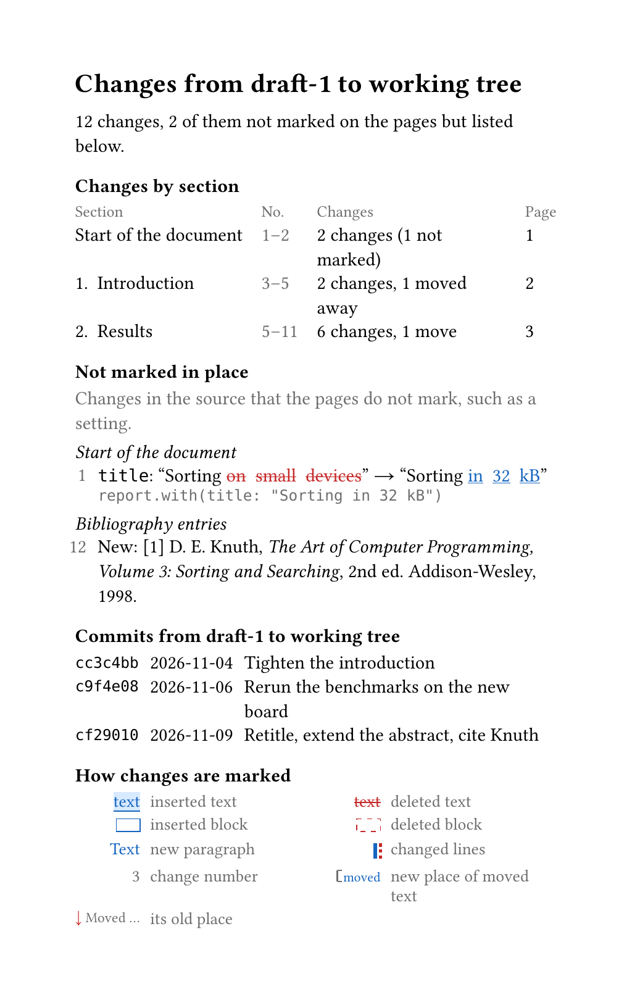
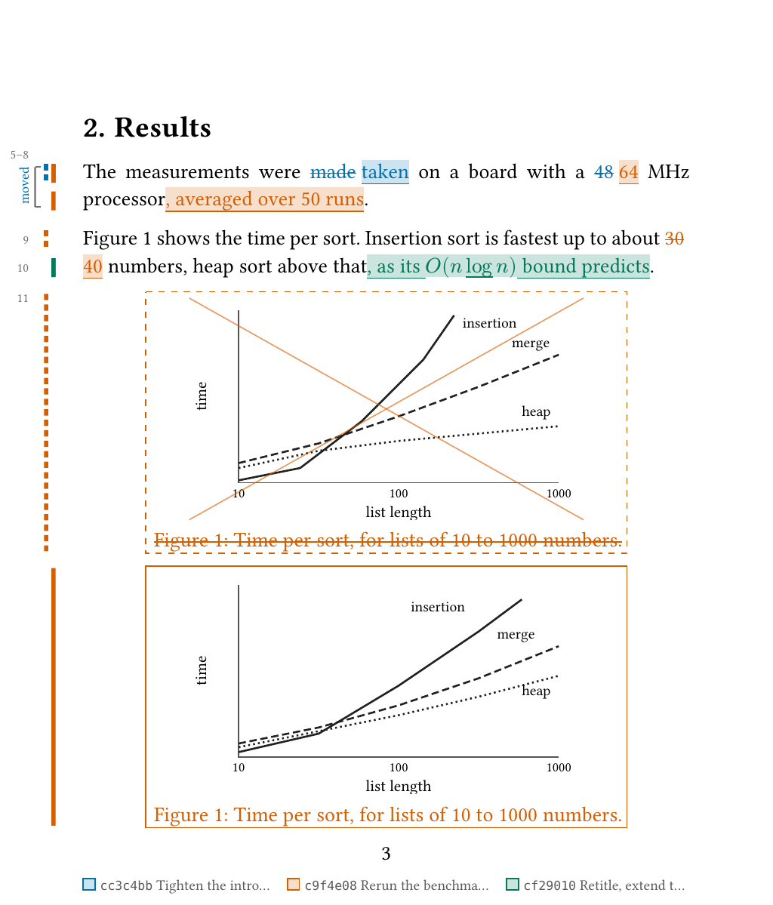
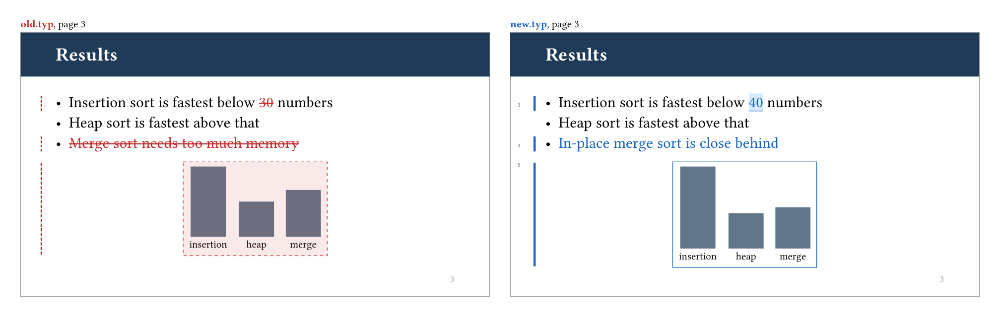

# Gallery

Each picture is a page of a PDF that `typst-redline` made from the files linked next to it, rendered unchanged. [make-pictures.sh](make-pictures.sh) makes them all again.

## Text, formulas and figures

Deleted words are struck out in red and new ones highlighted in blue; a new paragraph is blue. The old formula and plot are in dashed red frames, the plot crossed out, above the new ones in blue frames. The equation and the figure keep their numbers. Bars in the margin mark each changed line, with the number of each change next to them; the old and the new formula are one change and share a number.

```
typst-redline old.typ new.typ
```



Files: [paper/old.typ](paper/old.typ), [paper/new.typ](paper/new.typ).

## Moved text

The camera paragraph moved from *Setup* to *Analysis*, and its frame rate changed on the way. It is shown once, at its new place, with a grey bracket and a "moved" note in the margin; the edit is marked as usual. At the old place, a grey line names its first words and links to it. Both places show the move's number, 1.

```
typst-redline old.typ new.typ
```


Files: [moved/old.typ](moved/old.typ), [moved/new.typ](moved/new.typ).

## Several files and git

A report whose chapters are separate files, compared with a tagged commit three commits back. The first paragraph moved here from the introduction, which is another file. The plot is an SVG file that a later commit replaced; the `image` call did not change, and the figure is marked with the old image above the new one.

```
typst-redline main.typ --since draft-1
```


Files: the four commits are the folders [report/1](report/1) to [report/4](report/4), each holding the files that commit changed.

## The summary page

The last page of the same PDF. It gives the numbers and the count of the changes in each section and lists, by number, what has no mark on the pages: here the report's new title, which the template prints from a string argument, and a new bibliography entry. Then the commits in the range, and the legend.



## Who changed what

The same comparison with `--each-commit`: each change has the colour of the commit that made it, and the commits are listed in their colours in the bottom margin and on the summary page.

```
typst-redline main.typ --since draft-1 --each-commit
```



## Slides side by side

`--layout side-by-side` shows each changed slide next to its old version. Here a list item was replaced, a number changed and the chart was redrawn.

```
typst-redline old.typ new.typ --layout side-by-side
```



Files: [slides/old.typ](slides/old.typ), [slides/new.typ](slides/new.typ).
