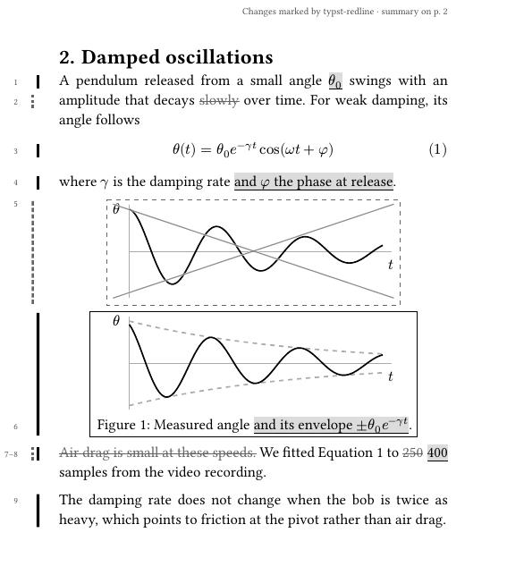
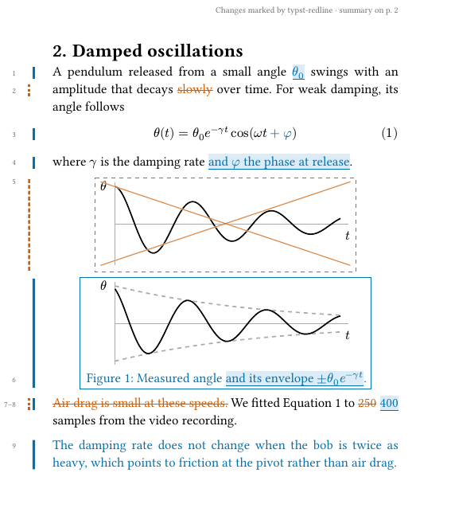
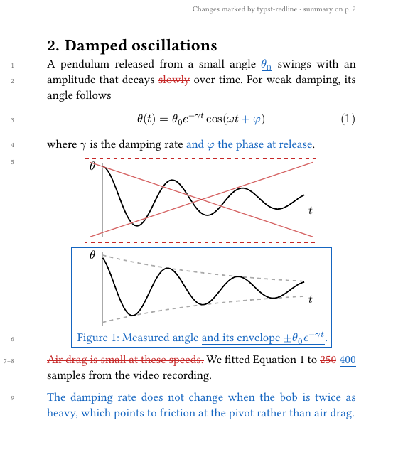
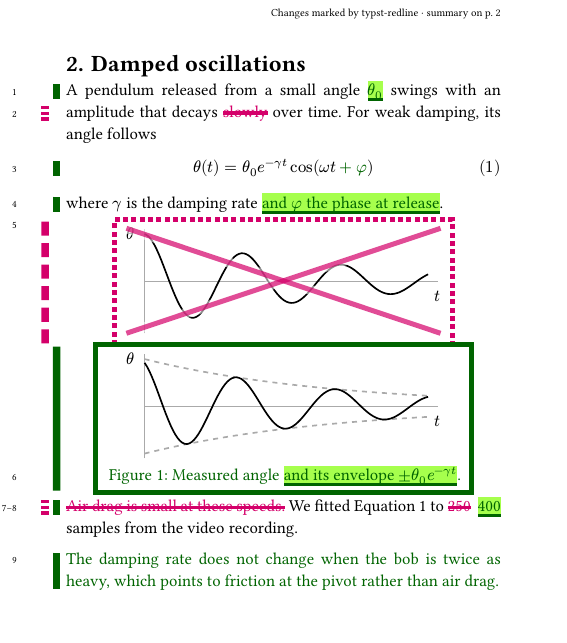
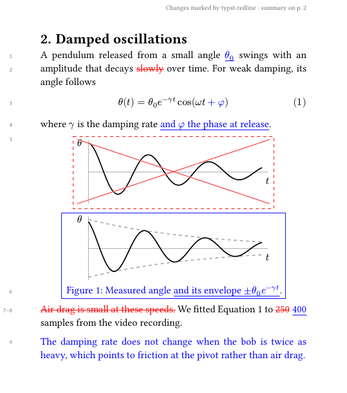
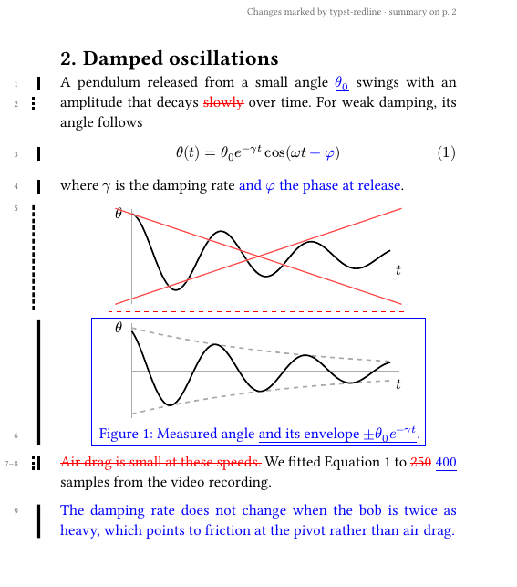
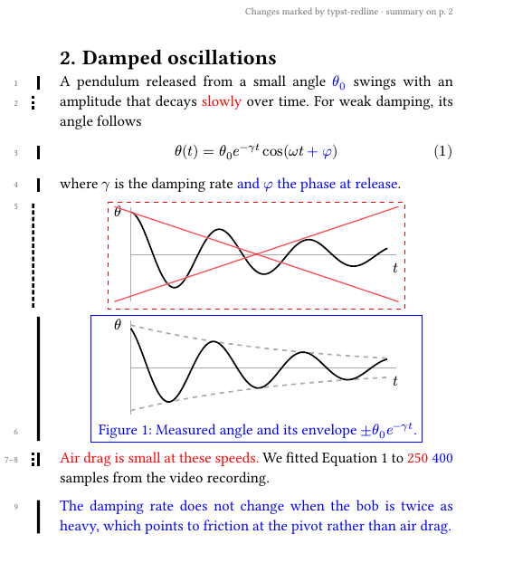
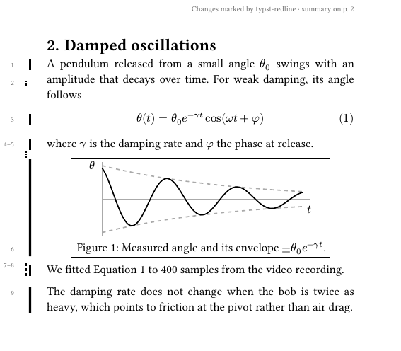

# Styling

`--style key=value` changes one setting of how changes look. `--style file.typ` reads several from a file that holds a Typst dictionary. Values are Typst code; repeat `--style` as often as needed, and later values win.

```
typst-redline paper.typ --style ins=purple --style ins-fill=none
typst-redline paper.typ --style my-style.typ
```

with `my-style.typ`:

```typ
(del: rgb("#b00000"), strike: 1pt, bars: none)
```

A style file can also start from a latexdiff type with the key `type`, and set `graphics-markup` as the option does, such as `(type: "UNDERLINE", graphics-markup: "new-only")`.

## Style files that apply by themselves

Two style files apply without an option, if they exist: the user's `typst-redline/style.typ` in `%APPDATA%` on Windows, and in `$XDG_CONFIG_HOME` or else `~/.config` on Linux and macOS; then a project's `.typst-redline.typ`, the first one found in the document's folder or a folder above it, up to `--root` or the git repository. `-t` and `--style` apply after them. An error in one of them is reported with its path.

## Example style files

[docs/styles](styles) holds a few to copy, shown here on the paper example:

<table>
<tr>
<td><br><a href="styles/greyscale.typ"><code>greyscale.typ</code></a>, greys only</td>
<td><br><a href="styles/blue-orange.typ"><code>blue-orange.typ</code></a>, no red or green</td>
</tr>
<tr>
<td><br><a href="styles/underline.typ"><code>underline.typ</code></a>, lines only</td>
<td><br><a href="styles/loud.typ"><code>loud.typ</code></a>, every mark as heavy as the keys allow</td>
</tr>
</table>

`-t UNDERLINE` is modelled on latexdiff's default type; the [latexdiff types](#latexdiff-types) below lists the others. The page of the [gallery](gallery.md)'s paper example with each of them, and with `--style ins=purple --style ins-fill=none`:

<table>
<tr>
<td><br><code>-t UNDERLINE</code></td>
<td><br><code>-t COLOR</code></td>
<td><br><code>-t CULINECHBAR</code></td>
</tr>
<tr>
<td><br><code>-t CCHANGEBAR</code></td>
<td><br><code>-t CHANGEBAR</code></td>
<td><br><code>--style ins=purple --style ins-fill=none</code></td>
</tr>
</table>

## Keys

| Key | Default | What it sets |
|---|---|---|
| `ins`, `del` | blue, red | Colour of inserted and deleted content, its frames and its bars |
| `ins-fill` | light blue | Highlight behind inserted words; `none` for no highlight |
| `del-fill` | light red | Behind deleted text where the text is light, as on a dark background; `none` for none |
| `underline` | `0.5pt` | Line under inserted words; `none` for none |
| `strike` | `0.065em` | Line through deleted text; `none` for none |
| `gap` | `0.25em` | Space between deleted content and the new content that replaces it |
| `ins-frame`, `del-frame` | `0.6pt`, `(thickness: 0.6pt, dash: "dashed")` | Frames of inserted and deleted formulas, figures and other blocks; `none` for none |
| `cross` | `0.75pt` | Lines that cross out deleted pictures, in a lighter `del`; `none` for none |
| `block-color` | `true` | Whether changed blocks take the colour of their mark: new ones coloured, old ones tinted or crossed out |
| `outset` | `(x: 0.4em, top: 0.3em, bottom: 0.5em)` | How far frames stand outside their block, a length or a dictionary as `rect`'s `outset` takes |
| `del-text`, `del-blocks` | `true`, `true` | Whether deleted text, and deleted formulas, figures, tables, code blocks and drawings, are shown; `false` leaves them out, and their bar and number stay |
| `bars` | `auto` | Change bars: `auto` in the colour of their mark, a colour for all bars, or `none`; the change numbers stay |
| `bar-width`, `del-bar-width` | `2pt`, `1.5pt` | Thickness of insertion and deletion bars; the dashes of a deletion bar scale with it |
| `bar-gap`, `lane` | `0.5cm`, `3.5pt` | Distance of the bars from the text, and between bars of different kinds |
| `move`, `move-stroke` | grey, `0.8pt` | Brackets and lines of moved text |
| `number` | grey | Change numbers in the margin and on the summary |
| `steps` | six colours | Colours of `--each-commit` and `--steps`, which replace `ins` and `del` |

`--graphics-markup new-only` sets `del-blocks: false`, and `--graphics-markup none` also `block-color: false` and both frames to `none`; `both`, the default, sets nothing. latexdiff's default is `new-only`, but there it is an option of its own, so the types below leave graphics markup at `both`. These keys and `--graphics-markup` act on formulas shown whole, in frames; the changed parts marked inside a formula take `ins`, `del`, `strike` and `del-text` as text does.

A stroke takes what it leaves out from its default, and its colour from its mark (`move` for `move-stroke`, a lighter `del` for `cross`): `strike: 1pt` is a thicker strike-through in the colour of `del`, `del-frame: (dash: "dotted")` a dotted frame of the default thickness, and `del: green` also makes the strike-through green. An unknown key is an error that lists the keys, and so is a value of a type the key does not take, such as `bars: 1`.

## latexdiff types

`-t NAME` (or `--type`, any case) starts from a type named after one of latexdiff's `-t` types and modelled on it, with its pure blue and red; `--style` applies after it.

- `UNDERLINE`: new text blue and underlined, deleted text red and struck through, no bars.
- `COLOR`: as `UNDERLINE`, without the underline.
- `CULINECHBAR`: `UNDERLINE` with black change bars.
- `CCHANGEBAR`: new text blue, deleted text red and not struck through, black change bars.
- `CHANGEBAR`: change bars, new text not otherwise marked, deleted content left out.

Where they differ from latexdiff's types of the same name:

- Typst has no wavy underline, so the underline is straight.
- Change bars are numbered, those of deleted text are dashed, and in `CHANGEBAR` they are black where latexdiff's follow the text colour.
- Changed formulas and figures keep their frames, which latexdiff does not draw.
- latexdiff's other types are not offered: `CTRADITIONAL`, `TRADITIONAL` and `CFONTCHBAR` (deleted text moved to a footnote or set in other fonts), `CFONT` and `FONTSTRIKE` (other fonts), `BOLD`, `INVISIBLE`, `PDFCOMMENT` and `LUAUNDERLINE`. The keys have no font settings.

The keys, not the types, set the look in detail; [loud.typ](styles/loud.typ) shows how far they go.

## A preamble of your own

`-p my-preamble.typ` (or `--preamble`) replaces the built-in styling whole, for changes that no key covers. `typst-redline --show-preamble > my-preamble.typ` writes the built-in one to start from; the comment at its top describes the functions the marked document calls. The data the tool passes to these functions can change between versions of `typst-redline`, so a preamble of your own can stop working after an update; `--style` and `-t` apply to the preamble of the version in use.
